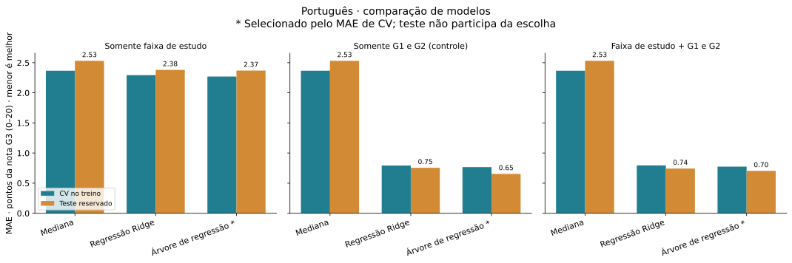
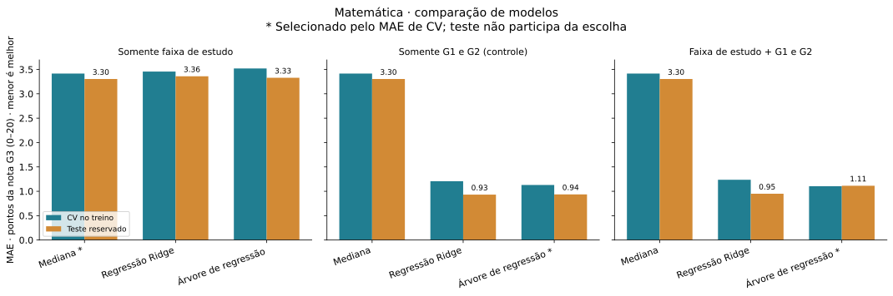

# Mineração, modelagem e validação

Previsão da nota final G3 · escala 0–20. Português é a análise principal; Matemática é comparação separada.

## Método

Alvo: G3, escala 0–20. Separação aleatória 80% treino / 20% teste, semente 42, estratificada pela faixa de estudo, dentro de cada disciplina. Os três cenários usam exatamente as mesmas partições. Validação cruzada de cinco partes no treino, também estratificada por faixa. GridSearchCV escolhe hiperparâmetros pelo menor MAE médio; o menor MAE de CV entre famílias (incluindo a referência) define o modelo selecionado antes de consultar o teste. Empates favorecem a ordem mediana, Ridge, árvore. One-hot para studytime, sem tratá-lo como horas ou impor intervalos iguais. G1/G2 são padronizadas dentro do Pipeline; cada ajuste usa somente o treino da dobra. Não há imputação, remoção de zeros, arredondamento ou truncamento de previsões. Os modelos finais são ajustados somente nos 80% de treino.

A referência prevê a mediana do treino, adequada ao MAE. Ridge usa alpha em {0,1; 1; 10; 100}; a árvore usa perda absoluta, profundidade em {2; 3; 5} e mínimo de registros por folha em {5; 15}. São 11 configurações por cenário. MAE é o erro absoluto médio; RMSE penaliza erros grandes; ambos estão em pontos de G3. R² pode ser negativo e não é percentual de acertos. Viés = média(previsto − real).

## Português

519 registros no treino e 130 no teste. Notas zero preservadas: 11 no treino e 4 no teste.

Somente faixa de estudo: seleção por CV = Árvore de regressão; MAE de teste 2,37, RMSE 3,31 e R² 0,069; variação do MAE frente à referência: 6,38% de redução. Uma redução negativa indica piora.

Somente G1 e G2 (controle): seleção por CV = Árvore de regressão; MAE de teste 0,65, RMSE 1,15 e R² 0,888; variação do MAE frente à referência: 74,16% de redução. Uma redução negativa indica piora.

Faixa de estudo + G1 e G2: seleção por CV = Árvore de regressão; MAE de teste 0,70, RMSE 1,20 e R² 0,876; variação do MAE frente à referência: 72,19% de redução. Uma redução negativa indica piora.

No treino de Português, Spearman estudo/G3 = 0,278 e eta² = 0,067. Eta² é a fração descritiva da soma de quadrados de G3 associada às diferenças de médias entre faixas, sem interpretação causal.

Ao acrescentar a faixa a G1/G2, a diferença de MAE de teste entre os modelos selecionados é 0,050 ponto(s) (com faixa menos controle; valor negativo indica menor erro). Essa comparação também pode refletir configurações distintas escolhidas por CV; não estima um efeito causal ou significância.

### Somente faixa de estudo

| Modelo | MAE CV | DP CV | MAE treino | MAE teste | RMSE teste | R² teste | Viés teste | Fora 0–20 |
|---|---:|---:|---:|---:|---:|---:|---:|---:|
| Mediana (referência) | 2,366 | 0,080 | 2,366 | 2,531 | 3,430 | -0,003 | 0,177 | 0 |
| Regressão Ridge | 2,293 | 0,192 | 2,252 | 2,380 | 3,302 | 0,071 | 0,094 | 0 |
| Árvore de regressão * | 2,270 | 0,167 | 2,249 | 2,369 | 3,305 | 0,069 | 0,046 | 0 |

Configuração selecionada: {"modelo__max_depth": 2, "modelo__min_samples_leaf": 5}. Previsões de teste fora de 0–20: 0.

| Faixa no teste | n | MAE selecionado | MAE referência |
|---|---:|---:|---:|
| Menos de 2 horas | 43 | 2,419 | 2,767 |
| 2 a 5 horas | 61 | 2,492 | 2,492 |
| 5 a 10 horas | 19 | 2,158 | 2,421 |
| Mais de 10 horas | 7 | 1,571 | 1,714 |

### Somente G1 e G2 (controle)

| Modelo | MAE CV | DP CV | MAE treino | MAE teste | RMSE teste | R² teste | Viés teste | Fora 0–20 |
|---|---:|---:|---:|---:|---:|---:|---:|---:|
| Mediana (referência) | 2,366 | 0,080 | 2,366 | 2,531 | 3,430 | -0,003 | 0,177 | 0 |
| Regressão Ridge | 0,793 | 0,092 | 0,787 | 0,755 | 1,110 | 0,895 | 0,010 | 0 |
| Árvore de regressão * | 0,767 | 0,094 | 0,678 | 0,654 | 1,147 | 0,888 | -0,008 | 0 |

Configuração selecionada: {"modelo__max_depth": 5, "modelo__min_samples_leaf": 5}. Previsões de teste fora de 0–20: 0.

| Faixa no teste | n | MAE selecionado | MAE referência |
|---|---:|---:|---:|
| Menos de 2 horas | 43 | 0,721 | 2,767 |
| 2 a 5 horas | 61 | 0,705 | 2,492 |
| 5 a 10 horas | 19 | 0,474 | 2,421 |
| Mais de 10 horas | 7 | 0,286 | 1,714 |

### Faixa de estudo + G1 e G2

| Modelo | MAE CV | DP CV | MAE treino | MAE teste | RMSE teste | R² teste | Viés teste | Fora 0–20 |
|---|---:|---:|---:|---:|---:|---:|---:|---:|
| Mediana (referência) | 2,366 | 0,080 | 2,366 | 2,531 | 3,430 | -0,003 | 0,177 | 0 |
| Regressão Ridge | 0,795 | 0,105 | 0,777 | 0,742 | 1,108 | 0,895 | 0,009 | 0 |
| Árvore de regressão * | 0,774 | 0,110 | 0,665 | 0,704 | 1,205 | 0,876 | -0,019 | 0 |

Configuração selecionada: {"modelo__max_depth": 5, "modelo__min_samples_leaf": 5}. Previsões de teste fora de 0–20: 0.

| Faixa no teste | n | MAE selecionado | MAE referência |
|---|---:|---:|---:|
| Menos de 2 horas | 43 | 0,756 | 2,767 |
| 2 a 5 horas | 61 | 0,787 | 2,492 |
| 5 a 10 horas | 19 | 0,447 | 2,421 |
| Mais de 10 horas | 7 | 0,357 | 1,714 |

### Padrões encontrados no treino

Os suportes são proporções do treino da disciplina. Os padrões foram extraídos sem usar as notas do teste.

| Faixa | n treino | Suporte | Média G3 | Diferença da média geral |
|---|---:|---:|---:|---:|
| Menos de 2 horas | 169 | 32,56% | 10,91 | -1,02 |
| 2 a 5 horas | 244 | 47,01% | 12,07 | 0,15 |
| 5 a 10 horas | 78 | 15,03% | 13,22 | 1,29 |
| Mais de 10 horas | 28 | 5,39% | 13,18 | 1,25 |

## Matemática

316 registros no treino e 79 no teste. Notas zero preservadas: 34 no treino e 4 no teste.

Somente faixa de estudo: seleção por CV = Mediana (referência); MAE de teste 3,30, RMSE 4,16 e R² -0,000; variação do MAE frente à referência: 0,00% de redução. Uma redução negativa indica piora.

Somente G1 e G2 (controle): seleção por CV = Árvore de regressão; MAE de teste 0,94, RMSE 1,89 e R² 0,794; variação do MAE frente à referência: 71,65% de redução. Uma redução negativa indica piora.

Faixa de estudo + G1 e G2: seleção por CV = Árvore de regressão; MAE de teste 1,11, RMSE 2,24 e R² 0,710; variação do MAE frente à referência: 66,28% de redução. Uma redução negativa indica piora.

No treino de Matemática, Spearman estudo/G3 = 0,081 e eta² = 0,011. Eta² é a fração descritiva da soma de quadrados de G3 associada às diferenças de médias entre faixas, sem interpretação causal.

Ao acrescentar a faixa a G1/G2, a diferença de MAE de teste entre os modelos selecionados é 0,177 ponto(s) (com faixa menos controle; valor negativo indica menor erro). Essa comparação também pode refletir configurações distintas escolhidas por CV; não estima um efeito causal ou significância.

### Somente faixa de estudo

| Modelo | MAE CV | DP CV | MAE treino | MAE teste | RMSE teste | R² teste | Viés teste | Fora 0–20 |
|---|---:|---:|---:|---:|---:|---:|---:|---:|
| Mediana (referência) * | 3,415 | 0,581 | 3,418 | 3,304 | 4,163 | -0,000 | 0,013 | 0 |
| Regressão Ridge | 3,456 | 0,528 | 3,433 | 3,360 | 4,204 | -0,020 | -0,718 | 0 |
| Árvore de regressão | 3,520 | 0,586 | 3,405 | 3,329 | 4,193 | -0,015 | -0,696 | 0 |

Configuração selecionada: {}. Previsões de teste fora de 0–20: 0.

| Faixa no teste | n | MAE selecionado | MAE referência |
|---|---:|---:|---:|
| Menos de 2 horas | 21 | 3,667 | 3,667 |
| 2 a 5 horas | 40 | 3,500 | 3,500 |
| 5 a 10 horas | 13 | 2,462 | 2,462 |
| Mais de 10 horas | 5 | 2,400 | 2,400 |

### Somente G1 e G2 (controle)

| Modelo | MAE CV | DP CV | MAE treino | MAE teste | RMSE teste | R² teste | Viés teste | Fora 0–20 |
|---|---:|---:|---:|---:|---:|---:|---:|---:|
| Mediana (referência) | 3,415 | 0,581 | 3,418 | 3,304 | 4,163 | -0,000 | 0,013 | 0 |
| Regressão Ridge | 1,207 | 0,214 | 1,192 | 0,932 | 1,611 | 0,850 | 0,044 | 1 |
| Árvore de regressão * | 1,130 | 0,321 | 1,047 | 0,937 | 1,889 | 0,794 | 0,076 | 0 |

Configuração selecionada: {"modelo__max_depth": 5, "modelo__min_samples_leaf": 15}. Previsões de teste fora de 0–20: 0.

| Faixa no teste | n | MAE selecionado | MAE referência |
|---|---:|---:|---:|
| Menos de 2 horas | 21 | 1,000 | 3,667 |
| 2 a 5 horas | 40 | 1,025 | 3,500 |
| 5 a 10 horas | 13 | 0,692 | 2,462 |
| Mais de 10 horas | 5 | 0,600 | 2,400 |

### Faixa de estudo + G1 e G2

| Modelo | MAE CV | DP CV | MAE treino | MAE teste | RMSE teste | R² teste | Viés teste | Fora 0–20 |
|---|---:|---:|---:|---:|---:|---:|---:|---:|
| Mediana (referência) | 3,415 | 0,581 | 3,418 | 3,304 | 4,163 | -0,000 | 0,013 | 0 |
| Regressão Ridge | 1,237 | 0,180 | 1,211 | 0,950 | 1,632 | 0,846 | 0,033 | 1 |
| Árvore de regressão * | 1,105 | 0,332 | 0,962 | 1,114 | 2,240 | 0,710 | 0,329 | 0 |

Configuração selecionada: {"modelo__max_depth": 5, "modelo__min_samples_leaf": 5}. Previsões de teste fora de 0–20: 0.

| Faixa no teste | n | MAE selecionado | MAE referência |
|---|---:|---:|---:|
| Menos de 2 horas | 21 | 1,238 | 3,667 |
| 2 a 5 horas | 40 | 0,975 | 3,500 |
| 5 a 10 horas | 13 | 0,615 | 2,462 |
| Mais de 10 horas | 5 | 3,000 | 2,400 |

### Padrões encontrados no treino

Os suportes são proporções do treino da disciplina. Os padrões foram extraídos sem usar as notas do teste.

| Faixa | n treino | Suporte | Média G3 | Diferença da média geral |
|---|---:|---:|---:|---:|
| Menos de 2 horas | 84 | 26,58% | 10,11 | -0,17 |
| 2 a 5 horas | 158 | 50,00% | 9,96 | -0,31 |
| 5 a 10 horas | 52 | 16,46% | 11,00 | 0,73 |
| Mais de 10 horas | 22 | 6,96% | 11,41 | 1,14 |

## Limitações e interpretação

Validação interna, em uma única divisão aleatória de dados históricos de duas escolas portuguesas. Não mede transferência para outras escolas, épocas ou alunos da FATEC. Não há validação externa ou temporal, intervalos de confiança ou testes de significância. O desvio-padrão do MAE nas dobras descreve variação; não é intervalo de confiança. A CV utilizada para escolher configurações é otimista como estimativa final; o teste reservado fornece a avaliação final. Resultados por faixa têm amostras pequenas. Há alunos compartilhados entre disciplinas: elas não são reunidas, nem tratadas como replicações independentes. A fonte já foi explorada na EDA; o teste é reservado nesta rotina de ajuste, sem equivaler a uma amostra externa nunca examinada. G1/G2 só estão disponíveis após os períodos anteriores; esses cenários não servem para previsão no início do ano. Modelos e padrões não demonstram causalidade nem isolam efeito do estudo.

## Rastreabilidade e artefatos

Execução UTC: 2026-11-08T19:37:47.911278+00:00. SHA-256 da base: 7bc28aa49e07779de6780dbbe07406e035ceb9c53d6b54ce519f38679229aa7e. Ambiente: {"python": "3.12.14", "numpy": "2.5.4", "scipy": "1.18.1", "scikit_learn": "1.9.1", "matplotlib": "3.11.2", "joblib": "1.6.0"}.

resultados.json contém métricas completas, busca de hiperparâmetros, contagens por faixa e hashes das partições. metricas.csv resume os 18 modelos. padroes_treino.csv e teste_por_faixa.csv contêm somente agregados. modelos/ contém seis Pipelines selecionados em joblib, gerados localmente e ignorados pelo Git; incluem o preparo ajustado somente no treino. Arquivos TXT na mesma pasta descrevem as regras, constantes ou coeficientes e a padronização. Só carregar arquivos joblib de origem confiável. Não são exportadas previsões individuais ou posições de origem.

Fonte: [Cortez (2008), Student Performance/UCI](https://doi.org/10.24432/C5TG7T). Licença: [CC BY 4.0](https://creativecommons.org/licenses/by/4.0/). Modelos, tabelas e gráficos derivados pelo projeto.

Referências técnicas: [prevenção de vazamento com Pipelines](https://scikit-learn.org/stable/common_pitfalls.html), [GridSearchCV](https://scikit-learn.org/stable/modules/generated/sklearn.model_selection.GridSearchCV.html) e [métricas de regressão](https://scikit-learn.org/stable/modules/model_evaluation.html).
